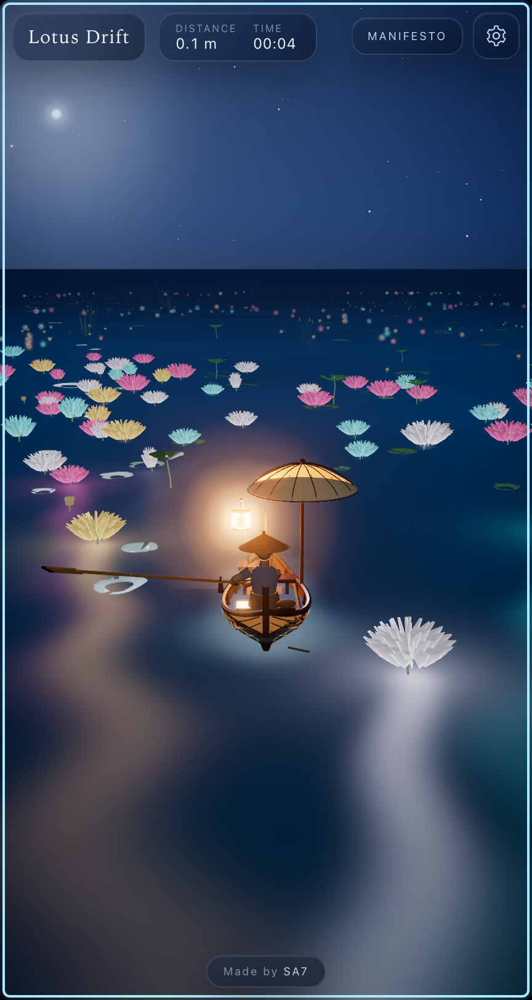
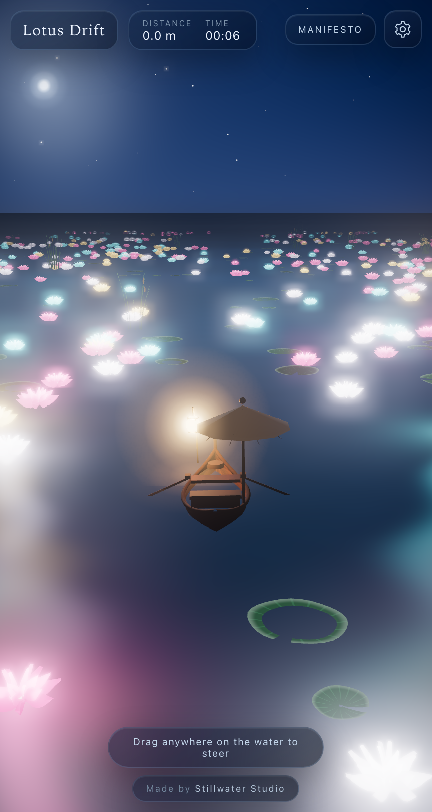
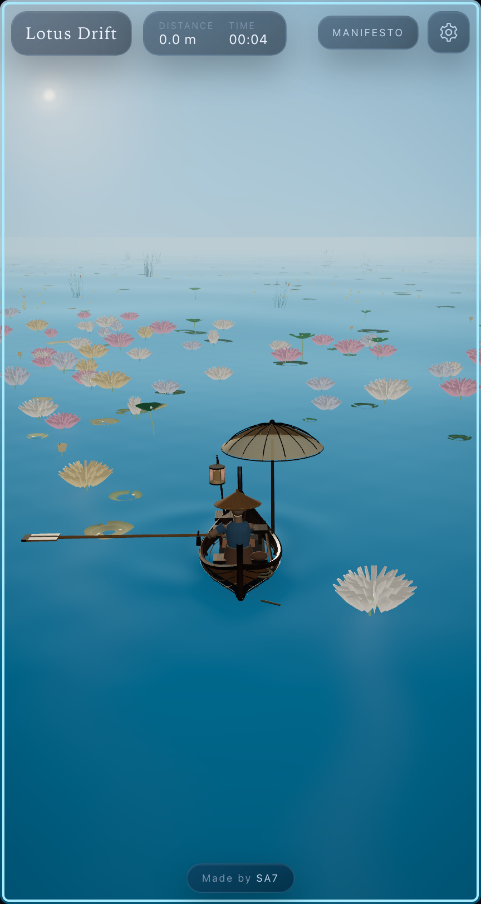
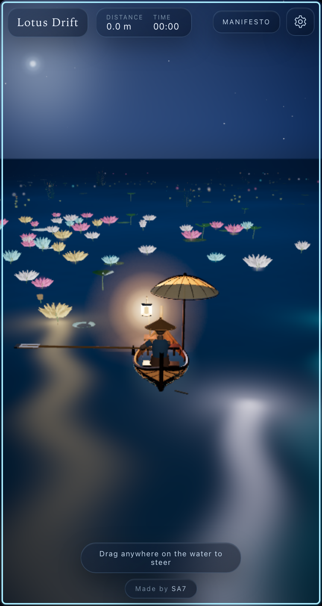

# Lotus Drift

A slow, meditative boat ride across a night pond filled with glowing lotus flowers.
No score, no enemies, no fail state — just water, light, and the sound of an oar.

Built with **Vite + vanilla JavaScript + Three.js**. Every mesh, texture, and sound
is generated procedurally at runtime; the project has no external asset downloads
and no backend.



*Night / High realism. See also [daylight](artifacts/realism-day-final-3.png) and the
[Light tier](artifacts/realism-light-boatman.png).*

## Realism pass (November 2026)

The pond was rebuilt around four procedural systems. Everything is still generated
at runtime; there are no new assets, model downloads, or network requests.

### The boat

- Carvel-planked hull: six strakes per side, separate inside planking, seven curved
  ribs, gunwale rails, raised bow/stern posts, two thwart seats, floorboards, a woven
  mat, rope coil, bamboo pole and a couple of worn repair patches.
- Thin tarred seam tubes between planks, procedural wood grain/knots/wear maps, and a
  dark glossy wet band with a faint waterline highlight just above the surface.
- Oiled-paper umbrella with bamboo ribs (the ribs read through the paper) and a paper
  lantern with a flickering flame, soft halo sprite, and warm point light.
- Independent heave, roll, and pitch springs; the boatman's weight shift rolls the
  hull. Bow/stern foam, a soft contact shadow, a speed-scaled wake ribbon and a local
  hull displacement in the water shader complete the floating contact.

### The boatman

- A seated ~3–5k-triangle figure built from procedural capsules/spheres: hips, spine,
  shoulders, elbows, wrists, head, hands and legs, a conical straw hat, and a kurta
  and lungi with cloth normal maps. Facial features stay soft and minimal.
- One rowing cycle — catch, pull, release, recovery — with stroke rate tied to boat
  speed (~0.4–1 stroke/s). Both hands are solved with a two-bone IK onto the moving
  oar grips; the oar pivots on a fixed oarlock.
- Idle breathing, relaxed posture shifts and head turns toward nearby flowers. The
  hull responds to his weight shift. `prefers-reduced-motion` makes the cycle subtler.
- Blade entry spawns a splash and ripple ring; exit spawns drips. The existing oar SFX
  fire from the same stroke-phase events. **Show boatman** hides the figure and oar;
  the boat remains fully usable.

### Lotus, pads, leaves and reeds

- Three flower LODs: **≈656 / ≈240 / ≈32 triangles**. The high flower has 42 petals
  in three cupped layers plus a seed pod with seed holes, yellow stamens, a bent stem
  and spent-petal state. Bloom stage, hue, glow, phase and scale are per-instance.
- Custom petal shader: back-lit translucency, bright tip to deeper base, veined normal
  bump, waxy wet highlight and fresnel rim. The cheap tier replaces the subsurface
  and atlas path with a flat emissive gradient. At day the glow tint is removed and
  the natural petal bases show.
- The field mixes closed buds, half-open flowers, open blooms and a few spent pods in
  the four original glow colours (pink, white, cyan, yellow).
- Pads have a radial notch, shared vein atlas, waxy specular and procedural droplet
  glints. Elevated cupped leaves have stems, small tears, edge curl and a dew bead.
  Pads and leaves tilt and react to the boat's wake through the per-instance
  displacement field.
- Reeds vary in height and thickness, with cattail heads and dry tips; wind sway
  stays in the vertex shader.

### LOD budget

| LOD | Distance | Lotus tris/flower | Detail |
| --- | --- | --- | --- |
| High | < 30 m | ≈656 | 42 petals, pod, stamens, full petal shader, halo |
| Mid | 30–62 m | ≈240 | layered petals, cheaper shading |
| Low | > 62 m | ≈32 | silhouette-level flower plus halo |
| Boatman | near | ≈3–5k | IK rig, cloth/wood maps, oar |
| Leaves | near/far | two meshes | high/low cupped leaf |

One lotus LOD is visible per flower instance, while the other two stay allocated in
GPU geometry. **Light** starts at the mid LOD (skipping high) and uses the cheap petal
shader; **High** uses the full range. Distances are measured from the camera to the
flower chunk.

### Lighting and atmosphere

- Bloom is thresholded so only bright cores, the lantern, and waterline highlights
  spread; petals rely on their own translucent colour and soft core halo.
- A faint low mist layer hugs the water in addition to the existing drifting layers;
  far flowers soften through distance fog and the low LODs.
- Day is a soft, hazy morning with a blue sky, warmer/larger sun, stronger key light,
  a contact shadow under the hull, and no flower glow. Night keeps the moon path, the
  warm lantern pool and the bioluminescent field.

### Before / after

**Before.** The original boat was a smooth, low-poly silhouette with no rower, the
lotus field used one flower mesh with flat pads, and there was no wet waterline, hull
displacement, boatman weight or contact shadow.



**After.** A hand-planked boat and rower read clearly against the lantern, the hull
has visible strakes and a wet band, lotus flowers show layered petals and seed pods,
and the pads/leaves react to the wake.





## Run it

Requires **Node.js 18+** and npm.

```bash
npm install
npm run dev
```

Open <http://localhost:3000>. The dev server is configured for port 3000 with
`strictPort`, so stop anything already using that port first (or change `server.port`
in `vite.config.js`).

Production build and preview:

```bash
npm run build
npm run preview
```

The build outputs a static site in `dist/`; it can be hosted anywhere that serves
files over HTTP(S). No environment variables are needed for normal local use.
`PREVIEW_HOST` is only used by the managed cloud preview to allowlist its hostname.

## Controls

| Action | Keyboard / mouse | Touch |
| --- | --- | --- |
| Row forward | `W` / `↑` | Drag or hold on the water ahead |
| Brake / reverse | `S` / `↓` | Drag behind the boat |
| Steer | `A` / `D` / `←` / `→` | Drag toward the desired direction |
| Steer continuously | Press and drag on the water | Press and drag anywhere on the water |
| Toggle FPS | `F` | Show frame rate in Settings |
| Close a dialog | `Esc` | Close / Stay a while button |
| Settings | Gear button | Gear button |

The optional on-screen joystick appears on coarse-pointer devices when **Touch
joystick** is enabled. On desktop it stays out of the way.

**Realism detail** (High / Light / Automatic) and **Show boatman** (default on) live
in Settings.

## The experience

- **A living pond.** The camera follows a hand-built wooden sampan with visible
  planks, ribs and thwarts, a cream umbrella and a warm lantern. The hull bobs on
  sampled waves, heels into turns, and sways while idle. A seated boatman pulls a
  long oar in a slow, speed-synced rowing cycle; splash, drip and ripple events land
  on the stroke frames.
- **Dense lotus fields.** Four glow colours — pink, white, cyan, and yellow — with
  layered, cupped petals, a seed pod and stamens, buds/blooms/spent pods, a soft core
  halo, and a shader-driven sway and pulse. Veined pads, elevated lotus leaves and
  reeds fill the spaces between them.
- **An endless drift.** Content is generated in deterministic 40 m chunks around the
  boat (a 7×7 neighbourhood). Chunks are recycled as you travel, with distance-based
  LOD, so the pond never runs out and the horizon stays hidden in fog.
- **Reactive water.** A custom water shader combines animated wave normals, fresnel
  sky reflection, a broken moon path, faux coloured reflections from nearby glowing
  flowers, ripple rings, and exponential fog. The hull adds a local normal
  displacement; the boat leaves a speed-scaled ribbon wake, and lotus, pads and
  leaves near the hull are pushed gently aside and brighten as you pass.
- **Time of day.** Night, Day, and Automatic. Automatic drifts through a full cycle
  every four minutes. Palette, fog, lights, bloom, flower glow, and the moon/sun
  glow all interpolate smoothly; no hard cuts. Day drops the flower glow and lights
  the boat with a warm sun key; night keeps the bioluminescent field.
- **Ambient life.** Drifting fireflies, rising motes and pale pollen near open
  blooms, a low water-hugging mist, a star field that twinkles, and a soft moon/sun
  halo.

## Architecture

```
src/
  main.js                  boot, render loop, input aggregation, quality + env wiring
  core/
    config.js              palettes, physics, world constants, creator name, defaults
    settings.js            localStorage-backed settings store
    quality.js             quality tiers + automatic frame-time adaptation
    loop.js                clamped requestAnimationFrame loop
    renderer.js            WebGLRenderer, EffectComposer bloom/vignette/output
    cameraRig.js           damped chase camera, gentle mode, speed FOV
    math.js                clamp, damp, angle wrap, formatters
    diagnostics.js         copyable performance report (GPU, resolution, draw calls)
  world/
    water.js               water shader + infinite horizon skirt
    waves.js               shared GLSL wave field
    sky.js                 gradient dome, stars, moon disc and halo
    textures.js            procedural moon, glow, mist, wood/cloth/paper, foam, vein atlas
    lotus.js               three lotus LODs, full/cheap petal shaders, stages, pod/stamens
    lilypads.js            instanced pads with notch, veins, droplets, bob/tilt shader
    leaves.js              elevated cupped lotus leaves with dew, tears, edge curl
    reeds.js               instanced reed clusters with cattails, dry tips, wind sway
    chunks.js              seeded chunk generation, mixed stages, recycling, LOD
    particles.js           pooled fireflies, rising motes, pollen
    mist.js                layered drifting mist planes
    environment.js         night/day palette interpolation
  boat/
    boat.js                planked hull, ribs/seats, umbrella, lantern, contact shadow
    boatman.js             rig, cloth/hat, IK rowing cycle, oar, splash/drip events
    physics.js             velocity, drag, steering, stroke impulses, drift
    wake.js                fixed ring-buffer ribbon + pooled ripple rings
  input/
    keyboard.js            held-key state, scroll prevention
    pointer.js             water-plane raycast steering
    joystick.js            optional touch joystick
  audio/
    engine.js              AudioContext, master/music/sfx buses, persistence
    music.js               generative ambient pad and plucked notes
    sfx.js                 filtered-noise water, oars, splashes, chimes, crickets
  ui/
    hud.js                 distance, time, FPS
    settings.js            modal/sidebar, reset, persistence
    manifesto.js           poetic statement modal
    focus.js               focus trap helper
    toast.js               transient messages
    styles.css             glassmorphism, responsive layout, safe areas
```

### Rendering

- Three.js `EffectComposer` with `UnrealBloomPass`, a custom vignette shader, and
  `OutputPass` for tone mapping / colour-space output. Bloom is disabled on Light
  and performance modes.
- No shadow maps or screen-space reflections. The boat gets a soft baked-style
  contact shadow, a cool stern key and warm lantern point lights; the water fakes
  flower reflections with a compact 8-light uniform array. This keeps the scene
  portable. Day adds a stronger warm sun key and haze while keeping the same
  shadow-free lighting model.
- The central water plane follows the boat. A large fogged skirt continues the pond
  to the horizon so the world never shows an edge.

### Flora instancing

Each chunk owns instanced lotus high/mid/low fields, a shared halo field, pads,
leaves and reeds. Only one lotus LOD renders at a time (see the LOD budget above);
the others stay allocated in GPU geometry. Flower stage, base hue, glow colour,
phase, scale and lean are per-instance attributes, and pads/leaves carry their own
push-away data. One 2×2 procedural vein/leaf atlas is shared across pads and petals.

Animation — sway, pulse, wind, wake push, droplet glints, and bob — happens in
vertex shaders using shared `uTime`, `uBoat`, `uMoonDir`, and wind uniforms. Only
uniform writes and a small number of chunk visibility checks happen on the CPU.

### Audio

All audio is synthesized with the Web Audio API; there are no tracks to license.

- A master bus feeds separate **Music** and **SFX** buses.
- Music is a generative pad (slow detuned oscillators through a low-pass filter with
  a feedback delay) plus sparse plucked notes. It evolves rather than looping, and
  its filter follows the light — slightly brighter by day, darker at night.
- SFX include filtered-noise oar strokes and splashes, water ambience, a cricket
  bed, and a rate-limited chime when passing close to a flower.
- The context starts only after the **Tap to begin** gesture. Volume and mute
  settings are persisted.

## Performance

- Quality tiers: **Light**, **Economy**, **Balanced**, and **High** (internal).
  They control DPR (capped at 2), bloom, MSAA, particle density, flower/leaf/pad
  density, glow density, water light count, and the `realism` detail level.
- **Realism detail** scales the flora and rower: High uses the full petal shader and
  all three lotus LODs plus fine boatman detail; Light starts at the mid LOD, uses
  the cheap petal gradient, fewer droplets/motes, lower mist and a simplified
  boatman; Automatic follows the selected graphics tier. Light also keeps the high
  boat and hull, so the silhouette never becomes a placeholder.
- Lotus LODs switch at **30 m** (high→mid) and **62 m** (mid→low). The high flower
  is budgeted at ≈656 triangles, mid ≈240, low ≈32; one LOD is drawn per instance.
  The boatman is ≈3–5k triangles. The Light tier skips the high LOD entirely.
- **Automatic** quality samples two-second windows and protects the frame budget in
  two stages. Below 50 FPS (28 FPS on coarse-pointer devices) it first lowers the
  internal render scale in small steps from 1.0× to 0.6×, which softens the image
  instead of visibly changing the scene; only when that headroom is spent does it
  drop a tier. Above 58 FPS (34 FPS on touch) it restores resolution gradually, and
  once back at 1.0× four good windows can raise the tier. The first few seconds have
  a grace period, and returning to Automatic from a manual choice starts fresh
  rather than inheriting an old downgrade.
- Pooled ring buffers for the wake and ripples, a fixed particle buffer, and no
  per-frame allocations in the hot path.
- Chunk frustum culling, distance LOD, and a DPR cap. Rendering pauses when the tab
  is hidden and resumes on return.
- `prefers-reduced-motion` reduces camera float, particles, and twinkle.
- WebGL context loss stops the loop and shows a toast; restore resizes and restarts.

Vite reports a single JS chunk of ≈672 kB because Three.js is bundled with the
scene (≈175 kB gzip). This is intentional for a one-scene app; splitting it would
add request overhead without improving the experience.

**Baseline before the realism pass:** a direct render of the full scene plus
post-processing measured ~3 ms per frame (≈315k visible triangles, 105 draw calls)
at 432×811 in a software-rendered harness. That number is a composition check, not
a GPU benchmark. This workspace's cloud browser now throttles canvas presentation
to roughly 2 FPS, so it cannot produce a meaningful after-pass FPS number. The
realism pass adds boat/boatman geometry and three flower LODs within the budget
above; target-hardware 60 FPS / mobile 30+ FPS remains the acceptance target, with
Automatic quality and Light/performance tiers as the fallbacks. Flora is instanced,
the hull is merged into a handful of meshes, and the hot loop does no per-frame
allocations.

## UI, accessibility, and responsiveness

- Glassmorphism HUD with distance (one decimal), elapsed time (MM:SS), and an
  optional FPS counter.
- Settings becomes a bottom sheet on narrow screens and a right-hand sidebar on
  desktop. Focus is trapped while open, `Esc` closes it, and focus returns to the
  pond afterward.
- `aria-label` / roles on the canvas, HUD, dialogs, radios, switches, and sliders;
  visible focus rings; reduced-motion support.
- Safe-area insets are respected; portrait and landscape layouts are handled, with
  a resize/orientation-change hook.
- Settings includes **Copy performance report**: GPU, canvas resolution, automatic
  render scale, frame time, draw calls and triangle count, ready to paste into a bug
  report when a particular device stutters.
- Page scrolling, overscroll, and pinch gestures are suppressed over the game
  surface. `user-scalable` is intentionally left enabled in the viewport for
  accessibility; the canvas itself uses `touch-action: none`.
- If WebGL2 is unavailable, a calm fallback message replaces the scene. A `<noscript>`
  message handles JavaScript being disabled.

## Settings and persistence

Settings are stored under `lotus-drift:settings:v1` in `localStorage`:

- Time of day: Night / Day / Automatic
- Graphics quality: High / Light / Automatic
- Realism detail: High / Light / Automatic
- Show boatman (default on)
- Gentle camera, Performance mode, Show frame rate, Touch joystick
- Music / Effects mute and independent volume
- **Reset to default** restores all of the above.

## Customising

- Creator credit: `CREATOR_NAME` in `src/core/config.js`, currently `SA7`. It is
  used on the HUD credit and in the manifesto footer.
- Physics feel: `PHYSICS` in `src/core/config.js`.
- Palette / bloom / fog per time of day: `PALETTES.night` and `PALETTES.day`.
- World density and chunk radius: `WORLD` in `src/core/config.js` and the counts in
  `src/world/chunks.js`.
- Camera feel: `src/core/cameraRig.js`.

## Assumptions and deliberate deviations

- **Camera angle.** The brief suggested a ~55° downward pitch. A literal 55° pitch
  hides the horizon, moon, and stars and turns the scene into a top-down flower
  carpet. The delivered camera is a low chase view (~16° down, 55° FOV) so the pond
  reads as a place and the sky is part of the composition. This is the main
  intentional deviation; `cameraRig.js` is the place to change it.
- **Day mode art direction.** Day is a soft, hazy morning rather than a harsh noon:
  a blue sky, a stronger warm sun, low bloom, paler water, no flower glow, and a soft
  contact shadow under the hull. There are still no shadow maps; this keeps the calm
  mood and the same lighting budget.
- **Audio.** Fully procedural; no Scott Buckley or other licensed track is used, so
  no third-party attribution is required.
- **Identity.** "Lotus Drift" is the project title and **SA7** is the creator
  credit. Change `CREATOR_NAME` (and the title in `index.html` if desired) before
  publishing under a different name.
- **Performance numbers.** The included time-of-day and quality settings are tuned
  by feel; the automatic manager is the safety net for slower devices.

## Changelog

### 2026-11-24 — Frame budget and diagnostics

- Automatic quality now lowers the internal render scale continuously (1.0× to
  0.6×) before it changes a tier, so a slow frame softens the image instead of
  popping bloom, MSAA and density down a level. Touch devices use a 30 FPS budget;
  desktops keep chasing 60.
- Added **Copy performance report** in Settings: GPU, canvas resolution, automatic
  scale, frame time, draw calls, triangles and program count. This makes the
  hardware acceptance target checkable on a real device instead of guessed at.
- The generative pad now follows the time of day: its low-pass filter opens in
  daylight and closes again at night, matching the palette shift.

### 2026-11-23 — Realism pass

- Rebuilt the boat with carvel planks, inner strakes, ribs, thwarts, gunwales, tarred
  seams, a woven floor mat, rope, bamboo pole, worn patches, wet waterline band,
  contact shadow, separate heave/roll/pitch springs and hull water displacement.
- Added a procedural seated boatman with a two-bone IK rowing rig, speed-synced
  catch/pull/release/recovery cycle, idle breathing and head turns, straw hat, cloth
  maps and oar splash/ripple/drip events tied to the existing SFX.
- Rebuilt lotus flowers as three LODs with layered curved petals, pod, stamens, mixed
  growth stages, four glow colours, a translucent/waxy petal shader and cheap shader
  fallback; added elevated cupped leaves, richer pads and reeds.
- Added the **Realism detail** setting and **Show boatman** toggle (both persisted),
  and made boatman visibility part of the settings store.
- Retuned bloom to favour cores/lantern, added a faint low mist layer and pollen,
  strengthened the day palette/sun, removed daytime flower and lantern halo glow,
  and added a soft contact shadow.
- Fixed a saved-settings startup crash: the boatman constructor discarded its drip
  mesh (`this.drips = null`) after building it, so the Light/`boatmanDetail: false`
  path threw in `setDetail(false)` before the start button was wired. The stale null
  assignment was removed and the hide path is now guarded. Light quality, saved
  Light settings, the quality switch and the boatman toggle all boot cleanly.
- Updated the README with the new systems, the LOD budget, and the before/after
  screenshots.

## Credits and licensing

- Copyright © 2026 SA7. All rights reserved.
- Code, procedural geometry, textures, and audio: original work by SA7.
- [Three.js](https://threejs.org/) — MIT License.
- [Vite](https://vitejs.dev/) — MIT License.
- No external images, fonts, audio files, models, or network requests at runtime.
  (The UI uses system font stacks.)
- Third-party dependencies retain their own licenses. Add a separate project
  license if you intend to grant redistribution rights.

## Known limitations / next ideas

- The water reflections are stylised light streaks and colour pools, not physically
  accurate screen-space reflections. Planar reflections or SSR would be the next
  visual step, at a real performance cost.
- There are no shadow maps; the boat and flowers are lit by directional, hemisphere,
  and fill lights plus emissive materials. A soft baked-style contact shadow sits
  under the hull, and the lantern lights nearby wood, cloth and water.
- The pond is endless but memoryless: distance and time reset on reload, and there
  is no save/return-to-a-place feature.
- The touch joystick is only offered on coarse-pointer devices. Hybrid laptops with
  touchscreens rely on drag steering unless the pointer media query reports coarse.
- Automatic quality needs a few seconds of samples after a long stall; the first
  seconds are intentionally given a grace period.
- Context-loss recovery depends on the browser actually restoring the WebGL context.
  If it does not, reloading is the fallback.
- Day and Automatic lighting are deliberately soft; a dramatic sunrise/sunset
  palette or weather system would be a nice expansion.
- Ideas: a photo mode, seeded journey sharing, distant mountains/reeds at the
  horizon, a second boat passing in the fog, rain ripples, and a slow ambient
  chord that follows the time of day.
